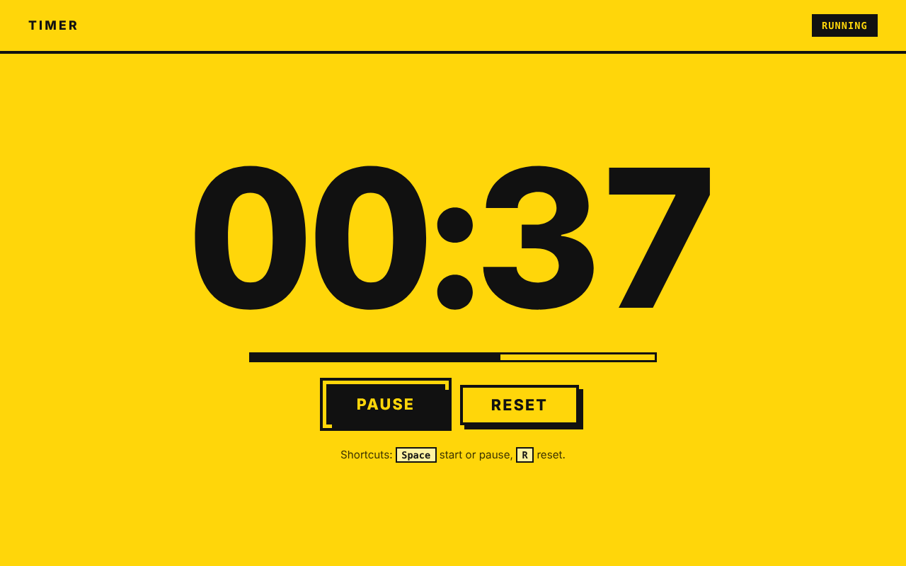
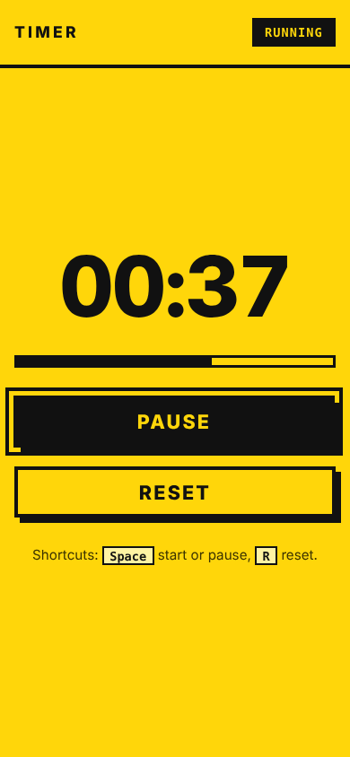

# Timer

A stopwatch with start, pause, resume and reset, built with plain HTML, CSS and JavaScript. No framework, no build step.

Live demo: https://timer-orcin-two.vercel.app

| Desktop | Mobile |
| --- | --- |
|  |  |

## Behaviour

- **Start / Pause / Resume:** one button. It reads "Start" at zero, "Pause" while running and "Resume" when paused. Pausing keeps the elapsed time.
- **Reset:** stops the timer and sets it back to `00:00`. It is disabled while the timer is at zero and idle.
- **Display:** `MM:SS`, switching to `H:MM:SS` after one hour. A bar under the digits fills over each minute.
- **Accurate time:** elapsed time is calculated from timestamps (`performance.now()`), not by counting interval ticks, so it does not drift when the tab is in the background and throttled.
- **Tab title:** shows the time while it matters, for example `01:05 · Timer (running)` or `01:05 · Timer (paused)`, and plain `Timer` when idle. You can watch it from another tab.
- **Keyboard:** `Space` starts or pauses and `R` resets when focus is not on a button. Buttons also work with `Enter` and `Space` as usual.
- **Not persisted:** reloading the page resets the timer.

## Accessibility

- The time is a `role="timer"` element, which is not read out every second.
- A separate polite live region announces state changes ("Started", "Paused at 1 minute 5 seconds", "Reset to zero") and each full minute while running.
- Visible focus rings, large touch targets, high contrast (black on yellow), `prefers-reduced-motion` respected, responsive from 320px up.

## Run it

```sh
python3 -m http.server 5254
# open http://localhost:5254
```

Any static server works, and it deploys to Vercel as a static site with no build step.

## Verification

Checked in headless Chromium with Playwright using a fake clock: start, pause (time holds while paused), resume, one hour rollover to `H:MM:SS`, reset, tab title and live region text at each step, keyboard shortcuts, and no console errors at 1280px and 390px widths. There are no unit tests.

## Known limitations

- Counts up only (no countdown or laps).
- Display resolution is one second.
- The state is not saved between page loads.

## Notes

UI and code quality improvements were made with AI assistance (Claude, Anthropic), reviewed and verified by building and running the app.
